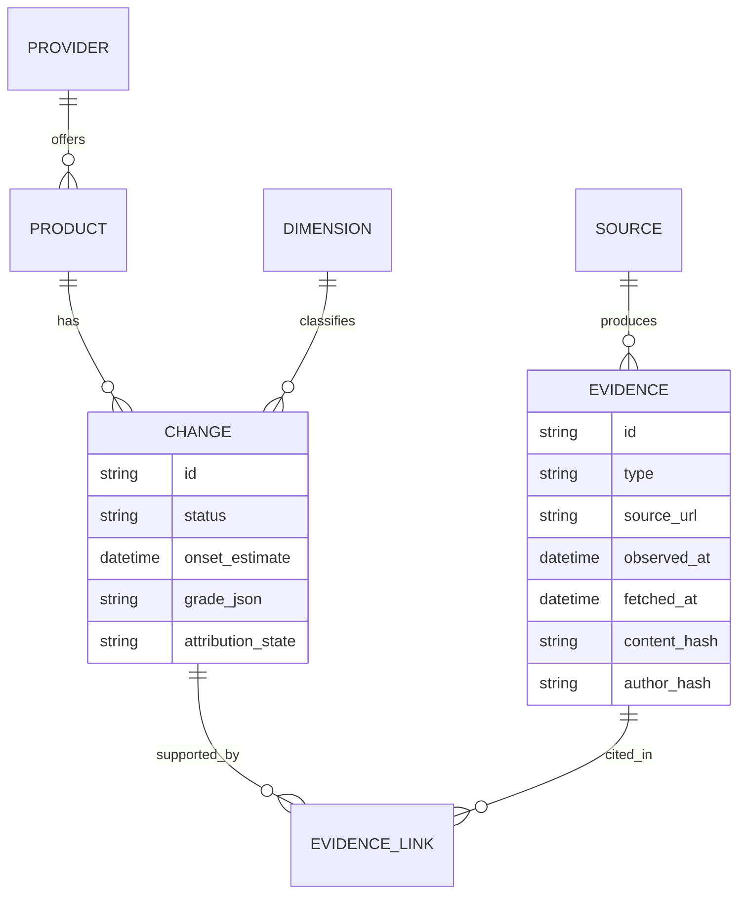
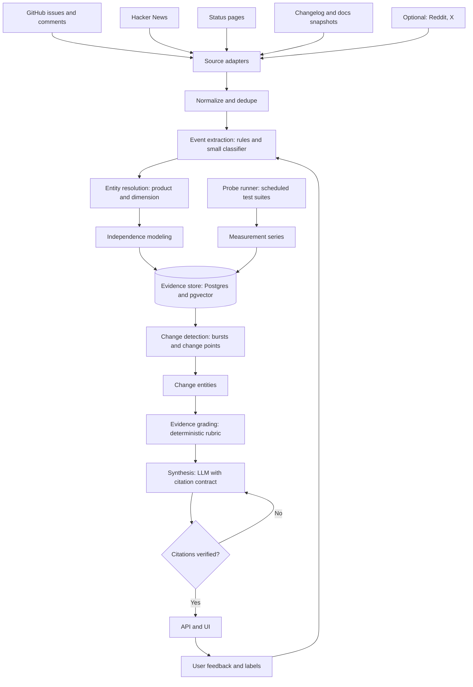
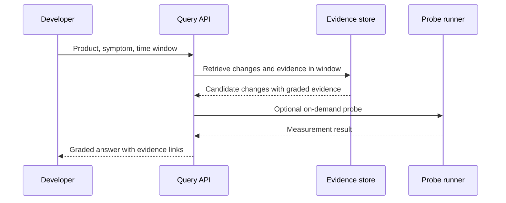
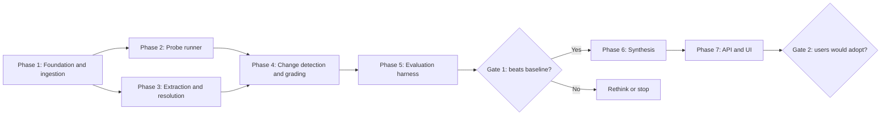

# External Change Intelligence for AI and Developer Platforms

Architecture and technical approach (working title)

---

## 1. Problem and solution

**Problem.** Teams building on third-party AI and developer platforms are changed under without clear notice: quality and behavior shifts, rate-limit and quota changes, tool-call and structured-output behavior, pricing, deprecations. Provider changelogs and status pages are late or silent. Own observability shows symptoms but cannot separate "our code" from "the provider". Community chatter has early signal but is noisy, correlated and unverified.

**Solution.** For each **Provider x Product x Dimension x Time**, produce graded, evidence-linked statements:

> What changed, when did it start, who observed it, what evidence supports it, and how confident are we?

Evidence comes from three families: community reports, provider documents, and controlled probes where the dimension is measurable.

**Two workflows**

1. Urgent: "Is it us or the provider?" Fast, evidence-linked answer during an incident.
2. Routine: "What changed in the last 30 days?" Graded change feed per product.

**Design rules**

- Observation is separate from attribution. State measurements confidently, hedge causes.
- No single truth score. Grade evidence on separate dimensions.
- AI interprets evidence. AI is never evidence. Every claim links to source items.
- Source independence is modeled explicitly.
- Probes are graded evidence, not ground truth.

**Non-goals.** No "model X got worse" verdicts. No single quality score. No startup-idea generation. No financial-access vertical in v1.

---

## 2. Scope of v1

| Item | Choice |
|---|---|
| Providers | 3 major AI API providers, 1 product each |
| Dimensions | Rate/quota limits, tool calling, structured output, refusal/behavior shifts. Latency and availability as context only |
| Open sources | GitHub issues and comments, Hacker News, status pages, changelog and docs snapshots |
| Optional sources | Reddit, X (access and cost uncertain; adapter interface must make them pluggable) |
| Measurement | Own probe runner |

Volume in this scope is modest (thousands to low tens of thousands of items per day). The architecture is sized for that. Kafka-class infrastructure is unnecessary.

---

## 3. Data model



**Evidence types:** `report`, `provider_doc`, `status_incident`, `probe_result`.

**Change status lifecycle:** `candidate` -> `corroborated` -> `measured` / `acknowledged` -> `expired` or `dismissed`.

**Provenance (non-negotiable).** Every evidence item stores source URL, fetch time, content hash, and a pointer to an immutable raw snapshot. Rubric and config versions are stored with each grade so score drift is auditable.

---

## 4. System architecture



---

## 5. Components

### 5.1 Source adapters

One adapter per source, same output schema, isolated failures.

| Source | Method | Notes |
|---|---|---|
| GitHub | REST/GraphQL search over provider SDK and tool repos | Issues, comments, reactions. Respect rate limits |
| Hacker News | Algolia search API | Stories and comments |
| Status pages | Statuspage-style JSON/RSS | Incident timelines are structured evidence |
| Changelogs and docs | Scheduled fetch, text snapshot, diff | Doc diffs are the main source for pricing, limits, deprecations |
| Reddit, X | Optional | Treat as an experiment; evaluate results with and without |

Store raw payloads in object storage. Reprocessing later is required as taxonomies improve.

### 5.2 Normalize and dedupe

- Canonical schema, language detection, URL canonicalization.
- Exact dedupe by content hash. Near-dedupe by SimHash/MinHash within a time window.
- Author identity stored as a salted hash only.

### 5.3 Event extraction (tiered)

| Tier | Method | Does |
|---|---|---|
| 0 | Keywords, product alias dictionary, regex | Prefilter obvious noise and non-relevant items |
| 1 | Small classifier or small local LLM | `is_change_report`, dimension, direction (worse/better/changed), first-hand vs hearsay, contains reproducible example |
| 2 | Frontier LLM | Only ambiguous cases, cluster-level decisions, synthesis |

Bootstrap labels with an LLM, then have a human verify a sample. Train the small classifier on the verified set.

### 5.4 Entity resolution

Keep this curated, not learned, in v1.

- Maintained alias table: model names, API names, SDK names, version strings -> Product.
- Fixed dimension taxonomy (Section 6).
- Unresolvable items go to a review queue and are never guessed.

### 5.5 Independence modeling

The goal is an **effective independent observation count**, not a raw count.

- Collapse near-duplicates, quote-posts, and cross-posts linked by URL.
- Weight comments within one thread sublinearly (for example log), since they are correlated.
- Penalize concentration: share of reports from one repo, thread, or community.
- Record this as separate fields: `raw_count`, `effective_count`, `concentration`.

### 5.6 Probe runner

A scheduled suite that runs fixed tests against each provider/product and stores raw outputs and metrics.

| Dimension | Probe | Output |
|---|---|---|
| Rate/quota | Read rate-limit headers on every probe call, compare with documented limits | Header value series |
| Tool calling | Fixed tool-schema suite | Pass rate, failure types |
| Structured output | JSON-schema conformance suite | Conformance rate |
| Refusal/behavior | Fixed benign prompt set, rule-based scoring first, LLM judge only as secondary | Refusal rate, format features |
| Latency/availability | TTFT, total time, error rate | Context series |

Rules:

- Deterministic settings, temperature 0, record the model identifier returned by the API on every call.
- Low QPS and a hard cost cap. Never stress-test limits. Infer limits from headers and documented values.
- Respect provider terms of service.
- **Vantage-point caveat.** One region and account tier will miss tier-, region-, or account-specific changes. Record the vantage point with every result and never describe a probe as ground truth.

### 5.7 Change detection

Two detectors feed one change entity.

1. **Report bursts.** Per (product, dimension), count classified reports in time buckets. Compare against a rolling baseline (EWMA or rolling median). Flag with CUSUM or a Poisson-style test. Confirm semantic coherence by clustering in-window reports (embeddings plus HDBSCAN).
2. **Measurement change points.** On probe series, run change-point detection (PELT or Bayesian online change-point) and report effect size with confidence interval.

Candidate changes are created when either detector fires. To limit false positives from multiple comparisons, require higher thresholds when only one evidence family supports a candidate.

### 5.8 Evidence grading

Deterministic, versioned, explainable. No LLM involved.

| Dimension of evidence | Levels |
|---|---|
| Volume | low / medium / high (by effective count) |
| Independence | low / medium / high (by concentration) |
| Reproducibility | none / partial / shared prompt-output examples |
| Measurement | not testable / not reproduced / reproduced |
| Provider confirmation | none / doc change / acknowledged |
| Recency and duration | stale / recent / ongoing |

**Status derivation**

- `candidate`: one evidence family
- `corroborated`: two or more families
- `measured`: probe reproduces
- `acknowledged`: provider confirms

**Contradictions.** Many reports but negative probe -> "Reported, not reproduced" (possibly tier- or region-specific). Probe change but no reports -> "Measured, no user impact reported". Never collapse these into one score.

**Attribution state (separate field):** `observed_only`, `temporally_associated`, `provider_confirmed`, `insufficient_evidence`. Output templates enforce allowed phrasing per state.

### 5.9 Synthesis

- Triggered when a change is created or its grade changes materially, or on-demand for a user query.
- The LLM receives only retrieved evidence IDs and grades. Output must be structured with a citation ID per claim.
- A verifier rejects and regenerates outputs with uncited claims, cited IDs that do not exist, or claims stronger than the grade permits (for example attribution beyond the attribution state).
- Cost scales with number of change entities, not number of posts.

### 5.10 API and UI

- **Change feed** per product with grades and evidence drill-down.
- **Incident query** ("is it us or the provider?"): input product, symptom, time window. Output relevant changes, grades, probe results, and the evidence trail.



Example output record:

```json
{
  "product": "provider-a/product-x",
  "dimension": "structured_output",
  "onset_estimate": "2026-09-14T09:30Z",
  "status": "measured",
  "evidence": {
    "volume": "medium",
    "independence": "medium",
    "reproducibility": "partial",
    "measurement": "reproduced",
    "provider_confirmation": "none"
  },
  "attribution_state": "temporally_associated",
  "summary": "Schema conformance fell from 99% to 94% beginning around Sep 14 [E12, E31, P7].",
  "uncertainty": "Probe vantage point is a single region and tier."
}
```

---

## 6. Dimension taxonomy (v1)

| Dimension | Primary evidence | Probe-verifiable |
|---|---|---|
| Rate/quota limits | Docs diffs, headers, reports | Yes (headers) |
| Tool calling | SDK repo issues, reports | Yes |
| Structured output | Reports, issues | Yes |
| Refusal/behavior shift | Reports | Partial |
| Latency/availability | Status pages, probes | Yes (context) |
| Pricing/deprecations | Docs diffs | Yes (documentary) |

The first four are the focus because reports carry real signal there and measurement is hard enough that triangulation adds value. Latency and availability are already well instrumented by others and appear only as context.

---

## 7. Storage and infrastructure

| Concern | Choice | Reason |
|---|---|---|
| Primary store | PostgreSQL | Relational model with link tables is enough. A graph database is not needed at this scale |
| Vector search | pgvector | Same database, simple operations |
| Time series | Plain Postgres (partitioned) or TimescaleDB | Probe series are small |
| Raw snapshots and probe outputs | S3-compatible object storage, immutable | Reproducibility and reprocessing |
| Jobs and scheduling | Postgres-backed queue plus cron or Prefect | Volume does not justify Kafka |
| Language | Python for adapters, extraction, probes, analysis | Best ML and stats ecosystem |
| API and scoring | Python (FastAPI) or Java (Spring Boot) | Pick one. Scoring is deterministic and testable either way |
| Models | Small local embedding model, small classifier, frontier LLM API with structured output | Tiered cost control |
| Frontend | Minimal web app | Evidence drill-down matters more than polish |

---

## 8. Cost and quality controls

- Tiered LLM use (Section 5.3). Frontier calls only at change-entity boundaries.
- Hard budget caps on probes and LLM calls.
- Every grade, rubric version, and prompt version is stored so results are reproducible.
- Human review queue for unresolved entities and low-confidence merges. Review decisions are labeled data for retraining the classifier.

---

## 9. Evaluation harness

Build this before synthesis and UI. It is the actual proof of value.

**Episode dataset**

| Field | Meaning |
|---|---|
| episode_id, product, dimension | Identity |
| type | `acknowledged`, `silent_confirmed` (later confirmed in docs or postmortem), `control` (matched window with no known change) |
| onset, acknowledgment time | Ground truth (where it exists) |

Aim for roughly 5 to 8 episodes initially, then grow. Split into development and held-out sets. Never tune on what you report.

**Replay mode.** Run the pipeline over frozen snapshots with a time cutoff so only data before time *t* is visible. Guard against leakage from edited or deleted content by relying on stored fetch timestamps and content hashes.

**Metrics**

| Metric | Question |
|---|---|
| Detection lead time | How early did a correct candidate appear versus acknowledgment? |
| Recall on acknowledged and silent-confirmed episodes | Did it detect them at all? |
| False-positive rate on control windows | Does it cry wolf? |
| Diagnosis time | How fast does it produce a correct explanation versus the baseline? |
| Grade calibration | Do "high" grades actually hold up more often than "low"? |

**Baseline to beat:** status page plus manual search.

**Known limits.** Silent, unconfirmed changes are unlabeled by construction. Recall can be measured only on confirmed events and precision only estimated through controls.

---

## 10. Build order (dependency-based)

1. Evidence schema, provenance, snapshotting, and source adapters.
2. Probe runner for two or three dimensions.
3. Normalization, extraction, and entity resolution.
4. Change detection and evidence grading.
5. Evaluation harness and baseline comparison.
6. Synthesis with citation verification.
7. API and UI.

Stop and reassess after step 5. If the evaluation shows no advantage over the baseline, steps 6 and 7 are not justified.

---

## 11. Go/no-go gates

1. Measurable advantage over the baseline on at least one of: lead time, diagnosis time, or false-positive rate.
2. Customer validation: of five interviewed teams building on LLM APIs, at least two say they would use it in an incident, and at least one signals willingness to pay.

Failing gate 1 means the engine does not earn its complexity. Failing gate 2 means a good technical project without a product.

---

## 12. Risks and mitigations

| Risk | Mitigation |
|---|---|
| Feature rather than company; observability vendors can add external signals | Validate demand early (gate 2). Differentiate on graded evidence and attribution discipline |
| Noisy, biased user reports | Independence modeling, reproducibility grading, probe corroboration |
| Probe vantage-point blind spots | Record vantage point, never treat probes as ground truth, surface "not reproduced" state |
| Silent changes have no labels | Control windows, held-out episodes, cautious claims about precision |
| Restricted data access (Reddit, X) | Core design depends only on open sources. Evaluate sensitivity with and without optional sources |
| Provider terms of service and probe cost | Low QPS, caps, header-based limit inference |
| Ungrounded LLM output | Citation contract, verifier, grade-bounded phrasing |
| Entity drift (new model names, renamed APIs) | Curated alias table with review queue |

---

## 13. Possible later extension

The same engine (entity, event, evidence, grade) applies to financial access harm, published only as documented complaint patterns with denominators and reporting-bias handling, never as predictions about named institutions. That vertical lacks a probe leg, so the reuse is partial. Revisit only after the first vertical passes both gates.

---

## 14. Phase-wise implementation plan

Ordered by dependency, not by time. Each phase has an exit condition. Customer interviews are deferred to Gate 2, and episode curation happens in Phase 5, with an early tripwire in Phase 1.



### Phase 1: Foundation and ingestion

**Goal.** A reproducible, time-aware evidence store.

**Build**

- Evidence schema with full provenance: source URL, fetch time, content hash, pointer to raw snapshot.
- Adapters: GitHub issues and comments, Hacker News, status pages, changelog and docs snapshots with diffs.
- Backfill mode for historical windows and a replay mode that exposes only data visible before a cutoff time. The evaluation harness depends on this.
- **Tripwire.** A tiny evaluation skeleton on 2 or 3 known episodes: manually check whether public signals exist before acknowledgment. If they do not, stop and rethink before building further.

**Stack.** Python 3.12 with uv, PostgreSQL 16 with pgvector, SQLAlchemy and Alembic, httpx, Pydantic, S3-compatible object storage (MinIO locally), Postgres-backed job queue (for example Procrastinate) or plain cron, Docker Compose.

**Exit.** Ingestion is idempotent, raw snapshots are immutable, and any past window can be replayed as of a chosen time.

### Phase 2: Probe runner

**Goal.** Trustworthy measurements for dimensions that can be measured.

**Build**

- Test suites: structured output conformance, tool-calling pass rate, rate-limit header capture, fixed refusal prompt set.
- Raw output storage, hard cost caps, and vantage point (region, account tier) recorded on every result.

**Stack.** Python, provider SDKs or httpx, pytest-style harness, the same scheduler, Postgres tables (TimescaleDB only if volume demands it).

**Exit.** Stable baselines with confidence intervals, and a measured run-to-run noise floor. If noise swamps plausible effects, redesign the probes before continuing.

### Phase 3: Extraction and resolution

**Goal.** Turn raw items into classified, independent observations.

**Build**

- Curated alias table (model, API, SDK names to Product) and the fixed dimension taxonomy.
- Labeled set: bootstrap with an LLM, verify a sample by hand.
- Small classifier for `is_change_report`, dimension, direction, first-hand vs hearsay.
- Near-duplicate collapse and effective independent count with a concentration measure.
- Review queue for unresolved entities.

**Stack.** sentence-transformers (small model such as bge-small), scikit-learn or Hugging Face transformers, datasketch (SimHash/MinHash), HDBSCAN, and a lightweight review UI.

**Exit.** Measured precision and recall on a held-out label set, and `effective_count` computed correctly on known duplicate-heavy threads.

### Phase 4: Change detection and grading

**Goal.** Candidate change entities with graded evidence.

**Build**

- Report burst detection against rolling baselines. Change-point detection on probe series.
- Candidate creation rules with higher thresholds when only one evidence family supports a candidate.
- Deterministic grading rubric as versioned pure functions, plus the attribution state field.

**Stack.** numpy, scipy, statsmodels, ruptures (PELT), pytest including property-based tests for grading functions.

**Exit.** The pipeline emits candidates for the episode windows, and any grade can be reproduced exactly from stored inputs and rubric version.

### Phase 5: Evaluation harness (Gate 1)

**Goal.** The real proof of value. A skeleton exists from Phase 1; complete it here.

**Build**

- Curate the full episode set: acknowledged incidents, silent changes later confirmed, and matched control windows. Split into development and held-out sets.
- Replay engine over frozen snapshots with time cutoffs.
- Metrics: detection lead time, recall on confirmed episodes, false-positive rate on control windows, diagnosis time versus baseline, grade calibration.
- Baseline definition: status page plus manual search.

**Stack.** Python, pandas, notebooks, versioned Parquet datasets (DVC optional).

**Gate 1.** Measurable advantage over the baseline on at least one metric. If it fails, do not build synthesis or UI. Reconsider scope, dimensions, or the idea.

### Phase 6: Synthesis

**Goal.** Readable explanations that never exceed the evidence.

**Build**

- Structured LLM output with a citation ID per claim.
- Verifier that rejects uncited claims, nonexistent IDs, and phrasing stronger than the grade or attribution state allows.
- Golden-file tests over a fixed set of change entities.

**Stack.** Frontier LLM API with structured output via Pydantic schemas. Verifier is plain tested code.

**Exit.** Zero uncited claims on the test set and no output stronger than its grade.

### Phase 7: API and UI (Gate 2)

**Goal.** The two workflows in front of real users.

**Build**

- Change feed per product and incident query ("is it us or the provider?") with evidence drill-down.
- Minimal interface. Drill-down matters more than polish.

**Stack.** FastAPI (or Spring Boot if preferring Java for the service layer) with server-rendered pages (Jinja and HTMX) or a small Next.js app.

**Gate 2.** Of five teams building on LLM APIs, at least two would use it in an incident and at least one signals willingness to pay.

### Cross-cutting from Phase 1

- Structured logging, OpenTelemetry traces, budget alerts on probes and LLM calls.
- Versioned config for rubric, prompts, and taxonomy.
- Secrets management, retention rules for raw data, periodic review of source and provider terms.

### Stack summary

| Concern | Choice |
|---|---|
| Language | Python for everything in v1 (Java optional later for the API) |
| Database | PostgreSQL with pgvector |
| Raw storage | S3-compatible object store |
| Jobs | Postgres-backed queue or cron |
| ML | sentence-transformers, scikit-learn or transformers, HDBSCAN |
| Statistics | scipy, statsmodels, ruptures |
| LLM | Frontier API with structured output, only at change-entity boundaries |
| Service and UI | FastAPI plus server-rendered or minimal web UI |

The decision points are the Phase 1 tripwire and Gate 1. Phases 6 and 7 are justified only if Gate 1 passes.